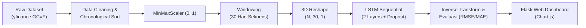

# Tugas Akhir 04 (TA-04): Prediksi Data Sekuensial Menggunakan LSTM
### Sistem Peramalan Harga Emas (*Gold Futures - GC=F*) Berbasis Deep Learning & Web Flask

Proyek ini merupakan implementasi menyeluruh alur kerja *Deep Learning* untuk data sekuensial deret waktu (*time series*) menggunakan **Long Short-Term Memory (LSTM)** dan diintegrasikan ke dalam aplikasi web interaktif menggunakan **Flask**, **Bootstrap 5**, dan **Chart.js**.

---

## 🎯 1. Deskripsi & Studi Kasus
* **Domain Permasalahan:** Keuangan & Investasi Komoditas (Prediksi Harga Emas Global).
* **Dataset:** Data historis harian kontrak berjangka emas (*Gold Futures*, ticker Yahoo Finance: `GC=F`) selama 3 tahun terakhir (755 hari perdagangan aktif).
* **Fitur Utama:**
  - `Date`: Stempel waktu kronologis.
  - `Close`: Nilai harga penutupan (target regresi deret waktu dalam satuan USD).
  - `Open`, `High`, `Low`, `Volume`: Informasi aktivitas pasar pendukung.

---

## 🧠 2. Alur Pemrosesan & Arsitektur LSTM



### Konfigurasi Model:
1. **Window Size (Timestep):** 30 hari. Model menggunakan observasi 30 hari perdagangan sebelumnya untuk memproyeksikan harga penutupan pada hari ke-31.
2. **Train-Test Split:** 80% data latih dan 20% data uji tanpa pengacakan (*shuffle=False*) guna mempertahankan kausalitas waktu.
3. **Arsitektur Jaringan (TensorFlow/Keras):**
   - Layer 1: `LSTM(units=50, return_sequences=True, input_shape=(30, 1))`
   - Layer 2: `Dropout(rate=0.2)`
   - Layer 3: `LSTM(units=50, return_sequences=False)`
   - Layer 4: `Dropout(rate=0.2)`
   - Layer 5: `Dense(units=1)`
4. **Kompilasi:**
   - *Optimizer:* `Adam`
   - *Loss Function:* `mean_squared_error (MSE)`
   - *Pelatihan:* 25 Epochs, batch size 32.

---

## 📊 3. Hasil Evaluasi Kinerja Model
Evaluasi dilakukan pada subset data uji (20% terakhir) setelah mengembalikan nilai skala normalisasi ke nilai moneter riil (USD) menggunakan `scaler.inverse_transform()`:
* **Root Mean Squared Error (RMSE):** ~\$193.16
* **Mean Absolute Error (MAE):** ~\$172.29
* **Tingkat Akurasi (100% - MAPE):** 95.97%
* **Proporsi Data:** 580 Sampel Latih (80%) vs 145 Sampel Uji (20%)

---

## 💻 4. Fitur Dasbor Web Interaktif (Flask + Chart.js)
1. **Sinkronisasi Data Otomatis (1-Click Sync):** Tombol *"Sync Yahoo Finance"* di navbar untuk memperbarui dataset langsung dari bursa komoditas Yahoo Finance tanpa perlu SSH/terminal.
2. **Ringkasan Real-time:** Harga pasar terakhir, proyeksi harga penutupan, persentase perubahan, serta indikator tren naik/turun (*NAIK (UP)* / *TURUN (DOWN)*).
3. **Kartu Metrik Evaluasi Model:** Menampilkan metrik RMSE, MAE, MAPE, dan proporsi sampel data latih/uji (80:20) sesuai Langkah 4 & 5 TA-04.
4. **Multi-Horizon Forecasting:** Pilihan rentang prediksi masa depan secara sekuensial (1 Hari, 3 Hari, dan 7 Hari ke depan).
5. **Tab Switcher Visualisasi:**
   - **Tab 1: Peramalan Masa Depan:** Grafik deret waktu 60 hari terakhir digabungkan dengan proyeksi titik masa depan berlingkaran kontras (*pointRadius 7px*).
   - **Tab 2: Evaluasi Model (Aktual vs Prediksi Data Uji):** Plot garis perbandingan antara data uji asli (*ground truth*) dengan hasil prediksi model LSTM.
6. **Simulator Skenario Harga Emas (Interactive What-If Simulator):** Memungkinkan penguji/dosen memasukkan skenario harga penutupan hari ini secara manual (atau memilih preset naik/turun) untuk melihat estimasi model LSTM pada hari berikutnya secara *real-time*.
7. **Ringkasan Statistik Pasar (60 Hari):** Harga terendah, harga tertinggi, dan rata-rata harga pasar.

---

## 📁 4. Struktur Direktori Proyek

```
ta04_lstm_gold/
│
├── dataset_timeseries.csv   # Dataset harga emas harian (bersih & terurut)
├── download_data.py         # Skrip pengunduh dataset via yfinance
├── train_lstm.ipynb         # Jupyter Notebook lengkap (Langkah 1 - 9)
├── train_model.py           # Skrip CLI pelatihan & penyimpanan artefak otomatis
├── app.py                   # Web Server Flask & REST API inferensi
├── requirements.txt         # Daftar pustaka dependensi proyek
│
├── model/                   # Direktori artefak model & scaler
│   ├── model_lstm.h5        # Bobot arsitektur model LSTM terlatih
│   └── scaler.pkl           # Objek MinMaxScaler tersimpan (Joblib)
│
└── templates/
    └── index.html           # Tampilan Dasbor Web (Bootstrap 5 & Chart.js)
```

---

## 🚀 5. Cara Menjalankan Proyek

### 1. Instalasi Pustaka
Pastikan dependensi telah terpasang:
```bash
pip install -r requirements.txt
```

### 2. Eksplorasi & Training via Jupyter Notebook
Buka dan jalankan seluruh sel pada notebook:
```bash
jupyter notebook train_lstm.ipynb
```

### 3. Menjalankan Dasbor Web Flask
Jalankan server aplikasi:
```bash
py app.py
```
Akses aplikasi melalui peramban web di:
👉 **`http://localhost:5000`** atau **`http://127.0.0.1:5000`**

